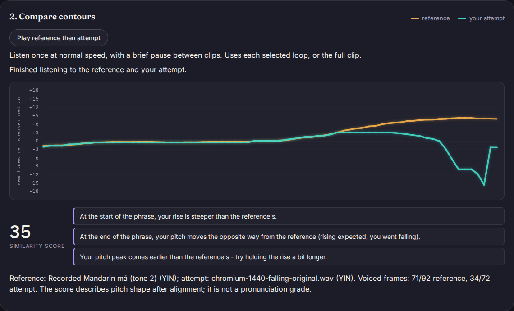
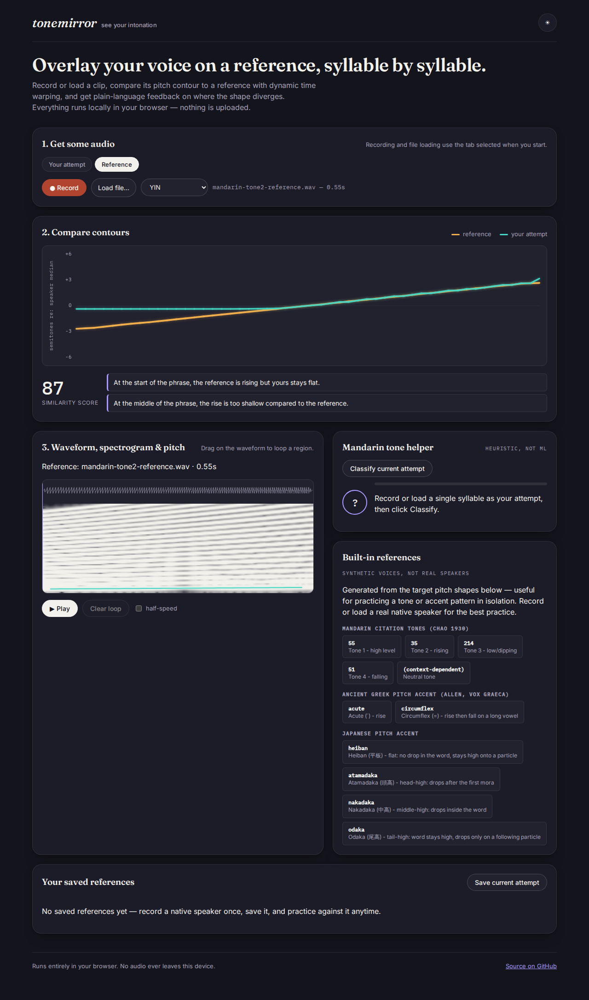
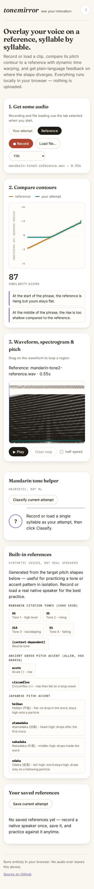

# tonemirror

**See your intonation.** Record a phrase, overlay your pitch contour on a
reference, and practice tones and pitch accent - entirely in the browser.

[](LICENSE)
[](https://antonsoo.github.io/tonemirror/)

Learners of tonal languages (Mandarin, Cantonese, Vietnamese, Thai) and
pitch-accent languages (Japanese, Ancient Greek) run into the same wall:
you can *hear* that your tone is wrong, but you usually can't tell *how* -
whether the rise started late, didn't go high enough, or was the wrong
shape entirely. A pitch contour makes that visible. tonemirror records (or
loads) audio, tracks its fundamental frequency with a from-scratch DSP
pipeline, aligns it to a reference with dynamic time warping, and turns the
misalignment into plain-language feedback like *"the rise is too shallow"*
or *"your pitch peak comes later than the reference's."*

Nothing leaves your device: no uploads, no accounts, no analytics.

**Start with recorded speech.** The source checkout and live demo include four isolated
Mandarin tones spoken on *ma*. Load mā, má, mǎ or mà, listen, and record your
own attempt. The original recording is bundled for offline use; its author,
license and selected source interval travel with saved clips and WAV exports.
[Recording, walkthrough and limits](studies/recorded-practice/README.md).

**Choose a file channel when a recording has separate voices.** Open **File channels**,
select a channel, and load it into either audio tab. Load the same stereo file
into both tabs to compare its channels. A mix that nearly cancels the voice now
keeps your previous clip and explains how to choose a channel. In a native
recorded-speech control, channel selection recovers all 227 voiced frames that
the old mix erased. [Recorded source, recovery and exact WAV exports](studies/file-channels/README.md).

The source checkout and live demo reject **non-finite decoded audio samples** before a new
clip is committed. A damaged file or saved recording leaves the previous clip
available for comparison, playback, saving and export. Real silence remains
valid audio. [Native decoder and worker reproduction](studies/audio-integrity/README.md)
documents the correction; [hosted build verification](studies/wav-export/publication/README.md) records its deployment.



_Recorded má (rising) as reference; recorded mà (falling) loaded as the attempt.
Both are excerpts from the credited source recording, not a learner study.
The plot includes pitch-tracker errors; the shape score is not a pronunciation grade._

**Unvoiced gaps stay visible after alignment.** Comparing the full recorded
four-tone sequence with itself used to draw the attempt's pitch through pauses,
including a 0.71-second interval where the detector supplied no voiced frames.
The source checkout and live demo preserve gaps from either clip through alignment and drawing.
A fresh replay of 580 recordings removes 17,170 unsupported connections while
keeping every alignment path, cost, score and feedback message unchanged.
[Native canvas traces, recordings and before/after views](studies/contour-gaps/README.md)
record the correction. These measurements concern the plotted observations,
not pronunciation accuracy or an improved pitch detector.

The source checkout and live demo support **first imports and recordings after the page has
loaded, even if the connection then disappears**. Pitch analysis, matching,
algorithm changes and saved-reference use need no additional code downloads.
[Reproduction with the static server shut down](studies/offline-start/README.md).
Opening or reloading the page itself still requires a connection or browser cache.

## Quickstart

```sh
git clone https://github.com/antonsoo/tonemirror.git && cd tonemirror
npm ci
npm run dev
```

Open the printed `localhost` URL, click **Load file...** under "Reference"
and load `examples/mandarin-tone2-reference.wav`, then do the same under
"Your attempt" with `examples/mandarin-tone2-attempt-late-rise.wav` - or
just click one of the built-in reference chips and record yourself.

## Features

- **Listen to both clips:** **Play reference then attempt** plays each clip once
  at normal speed with a short pause between them. Use a separate selected
  loop for each passage, or listen to the full clips. Stop cancels both;
  changing clips or starting individual playback also ends the sequence.
  [Recorded example and native audio verification](studies/paired-listening/README.md).
- **Recorded Mandarin practice:** four tone excerpts and the full sequence from
  [Wolfdog's 2019 recording](https://commons.wikimedia.org/w/index.php?title=File:FourMandarinTones.ogg&oldid=1277043205),
  under [CC BY-SA 4.0](https://creativecommons.org/licenses/by-sa/4.0/).
  Listen directly from the audio panel. Save, crop or download a reference
  with its credit intact. These are one speaker's isolated examples, with
  no claim of verified native-speaker status or pronunciation grading.
- **Audio out:** **Download WAV** exports the
  focused attempt or reference, including recordings and saved clips. Use
  **Keep region** first to download just a passage. Downloads preserve the
  decoded mono samples at normal speed; looping and half-speed playback do not
  alter them. Synthetic references carry a filename and WAV metadata marker,
  retained when reopened in ToneMirror. [Download and reload verification](studies/wav-export/README.md).
- **Audio in:** record with the microphone, or load a wav/mp3/ogg/m4a file
  (anything the browser's `decodeAudioData` supports). Mix all channels or choose
  a single channel before loading; explicit channel labels follow the clip. Recordings you save
  are kept in IndexedDB so you can record a teacher or native speaker once
  and practice against it indefinitely.
- **Pitch tracking**, implemented from scratch in TypeScript, running in a
  Web Worker: YIN and the McLeod Pitch Method (MPM), with voicing
  detection, octave-error correction, median smoothing, and semitone
  normalization relative to the speaker's own median pitch (see
  [Why semitones](#why-semitones-not-hz) below).
- **Comparison:** cancellable dynamic time warping between the reference's and
  attempt's voiced frames, a 0-100 pitch-shape score (unavailable without enough voicing), and rule-based
  localized feedback (direction, steepness, and peak-timing checks per
  third of the phrase).
- **Visualization:** a signature contour "staff" (reference vs. attempt,
  after DTW alignment) plus a waveform + own-FFT spectrogram view with a
  synced playhead, a draggable loop region, and half-speed playback that
  preserves pitch instead of lowering the voice an octave.
- **Mandarin tone helper:** a heuristic classifier for isolated syllables
  (tone 1 high-level, tone 2 rising, tone 3 low/dipping, tone 4 falling,
  neutral), reporting a confidence and the shape feature that drove the
  call. Explicitly labeled heuristic, not ML.
- **Pitch-accent templates:** Ancient Greek acute (rise) and circumflex
  (rise-fall), reconstruction-based; Japanese heiban/atamadaka/nakadaka/
  odaka as target shapes over a word's morae plus a following particle.
- **Generated patterns:** synthetic harmonic-complex voices for the four
  Mandarin tones and every accent template, generated in-browser and
  labeled synthetic everywhere they appear. Recording or loading real
  native-speaker audio is one click away and clearly encouraged in the UI.
- **Local processing without uploads**, no telemetry, ~271 kB
  of JS including workers, worklet and the pitch-preserving audio engine, uncompressed - see
  [Bundle size](#bundle-size)).

Light and dark themes follow the system preference (with a manual toggle),
and the current browser checks cover a 320px-wide phone:

 

Recording and file loading use the tab selected when you start, even if you
switch tabs while waiting. The waveform shows the current clip's name and
duration. Switching tabs pauses playback, and each clip retains its loop.
Arrow keys, Home, and End move between the audio tabs.
**Play reference then attempt** listens to the two clips without switching tabs.
It uses normal speed even when individual playback is set to half speed.
It keeps each clip's loop selection, samples, saved copy and comparison intact.
Starting or resuming outside a selected loop enters at its beginning. Moving a
loop past a playing cursor moves the audio and cursor together. Selecting a loop
while paused keeps that position until Play. [First-playback evidence](studies/loop-entry/README.md)
and the [earlier cursor study](studies/loop-playback/README.md) cover native
audio, live edits and half-speed coordinates.

**Half-speed, same pitch** prepares a playback preview on your device the
first time you play each clip slowly. Preparation can be cancelled, and the
preview is reused until that clip changes. Loop bounds and the playhead stay
in the original recording's time. Analysis, saved references and WAV downloads
keep the original samples. The MIT-licensed
[Signalsmith Stretch](src/vendor/README.md) engine is bundled for offline use;
its worker stops on cancellation, failure or a 60-second timeout.
[Rendered audio, recorded-speech measurements and browser checks](studies/slow-playback/README.md).

To practice a passage within a recording, drag on the waveform or enter
**Region start (s)** and **Region end (s)**. **Loop region** auditions those
bounds. **Keep region** makes that audio the current clip: comparison,
the tone helper and saving all use the excerpt. For example, keep one syllable
from a reference phrase, then record your attempt against that syllable.
The name shows its time range in the original recording. Repeated trims and
pitch-algorithm changes retain **Restore full clip** until you load new audio.
Failed or cancelled analysis keeps the previous clip. Extraction copies the
decoded samples without resampling; the start rounds down and the end rounds
up to sample boundaries. A cut need not fall at a zero crossing and can click
during playback. [Sample and browser checks](studies/practice-regions/README.md).

**Save current reference** or **Save current attempt** saves the selected tab's
clip only after you confirm a nonempty name. An excerpt saves only that audio;
its full source and restore history are not stored in the library.
Cancel saves nothing. If browser storage is unavailable, audio loading,
recording, and comparison still work. Saving errors appear beside the library,
and **Retry saved references** retries a failed library load. Saved recordings
belong to this browser profile and can disappear if its site data is cleared.

Browsing saved references reads only their names and categories; **Use** loads
the selected recording, and **Cancel work** can cancel that read. Existing
libraries gain a metadata index on first opening this source version. If another
old tab blocks that upgrade, close it and retry. The stored recordings stay in
place. [Reproduction and migration checks](studies/library-loading/README.md)
cover a synthetic 100-recording library with 192 MB of audio.

**Cancel work** stops pending imports, pitch extraction, contour matching and
slow-playback preparation.
Reference and attempt analysis have separate workers, so a stuck job in one
slot does not block the other. A failed or cancelled replacement keeps the
last successfully loaded clip, its playback and its comparison. **Retry audio
analysis** retries an extracted clip after worker failure; **Retry comparison**
retries matching without asking for the audio again. The comparison names its
two clips and the algorithm used for each.

Browser clips are limited to **60 seconds**, files to **25 MiB**, and microphone
capture stops at 60 seconds with that boundary in the clip name. Longer imports
are rejected, not silently shortened. See [audio boundaries](docs/audio-boundaries.md)
for decoded-audio limits and the native decoder's allocation/cancellation limits.

## How it works

### Pitch tracking

Each analysis frame is 2x the lag corresponding to the minimum trackable
frequency (default 60 Hz), hopped every 10 ms. Two independent F0
estimators are available:

- **YIN** ([de Cheveigné & Kawahara, 2002](https://doi.org/10.1121/1.1458024)):
  the difference function `d(tau)`, its cumulative-mean normalization
  `d'(tau)`, an absolute threshold walked to the local minimum, and
  parabolic interpolation for sub-sample lag precision. `src/core/yin.ts`.
- **McLeod Pitch Method / MPM** ([McLeod & Wyvill, 2005](https://www.cs.otago.ac.nz/graphics/Geoff/tartini/papers/A_Smarter_Way_to_Find_Pitch.pdf)):
  the Normalized Square Difference Function (NSDF), key-maximum peak
  picking with a clarity threshold chosen to prefer the true fundamental
  over its octave, and parabolic interpolation. `src/core/mpm.ts`.

Large frames use FFT correlations with the same lag and window definitions;
small frames retain direct sums. A [paired replay of 580 real recordings](studies/pitch-correlation/README.md)
found no voicing changes or pitch changes rounded to 0.001 Hz. The study retains
before/after timings, including the small-frame cases with no speed benefit.

After per-frame detection, `src/core/pitchTrack.ts` applies:

1. **Octave-error correction** - a frame whose F0 is ~2x or ~0.5x its local
   voiced-neighborhood median gets snapped back, a classic autocorrelation
   failure mode.
2. **Median smoothing** over voiced frames (unvoiced gaps are left alone so
   voicing boundaries don't get smeared).
3. **Semitone normalization**, described next.

#### Why semitones, not Hz

The whole point of overlaying two contours is comparing their *shape* - is
the rise as steep, does the dip land in the same place - not their
absolute pitch. A male reference speaker and a female or child learner can
differ by an octave or more in raw Hz, which would swamp any Hz-based
comparison. Converting each contour to semitones relative to *its own*
voiced median (`12 * log2(f0 / medianF0)`) puts both speakers on the same
scale regardless of their natural register, so the DTW and visual overlay
are comparing contour shape, which is what actually carries tone and pitch
accent.

### Comparison (DTW)

`src/core/dtw.ts` runs classic dynamic time warping (Sakoe-Chiba DP,
symmetric step pattern, absolute-difference local cost) between the two
contours' voiced semitone sequences. The mean cost per warping step maps
to a rounded 0-100 score via `100 * exp(-meanCost / 2.8)` (a 2.8-semitone average
divergence gives about 37). This is a descriptive pitch-shape distance, not a
pronunciation grade or a calibrated probability. Fewer than two usable voiced
frames in either contour leave the score and costs unavailable (`null` in the
core result), rather than assigning silence a score of zero. The same path time-
warps the attempt onto the reference's timeline for the "after alignment"
overlay, and drives rule-based feedback: for each third of the phrase, the
reference's and attempt's local slopes, normalized to each contour's voiced time
span, are compared for direction
(rising/falling/flat) and steepness, plus a check on how far apart the two
contours' pitch peaks land in time, each measured across its own voiced
span (so a pause before speaking doesn't count) and skipped when either
contour moves less than a semitone, since a flat contour has no peak to time.
A uniformly slower rendition is not mislabeled as a shallower pitch movement.
The rules also flag overly steep movement and movement against a level target.
No matched rule means no specific feedback, not a close match: local deviations
can still contribute to the score and appear in the overlay.

The alignment keeps two rows of cumulative costs and one byte per cell for
the backtrack, not the whole table of doubles, and gives the same path as
the full table (`tests/robustness.test.ts` checks it against one). Its time
and memory still grow with the two lengths multiplied, so a contour with
more than 6,000 voiced samples is sampled evenly down to 6,000, preserving both
endpoints. The result exposes original frame, usable voiced-frame and aligned
sample counts. Sampling is approximate and can change the score; it has no
general error bound. The browser's 60-second clips at the default 10 ms pitch
hop fit below this limit. Longer contours supplied to the core API use the
documented sampling path. Matching runs in its own cancellable worker.

### Mandarin tone classifier

`src/core/toneClassifier.ts` resamples a syllable's semitone contour to 16
points and applies a small decision tree over shape features (pitch range,
where the minimum falls, start/end position relative to the minimum, and
the Pearson correlation with a rising ramp) to call flat / dipping /
rising / falling / short-and-flat (neutral), matching the four citation
tones' canonical shapes from [Chao's five-point pitch scale](https://en.wikipedia.org/wiki/Tone_letter)
(Y. R. Chao, "A system of 'tone-letters'," *Le Maître Phonétique*, 45,
24-27, 1930). It only looks at the contour's relative shape, so it cannot
by itself tell "consistently high" from "consistently low" citation
tones - see [Limitations](#limitations-and-accuracy-caveats).

### Pitch-accent templates

- **Ancient Greek** acute (rise) and circumflex (rise-fall on a long
  vowel/diphthong), per the pitch reconstruction in W. S. Allen, *Vox
  Graeca: A Guide to the Pronunciation of Classical Greek*, 3rd ed.
  (Cambridge University Press, 1987). No audio of Ancient Greek survives;
  this is a scholarly reconstruction, not a recording of a real accent.
- **Japanese** heiban/atamadaka/nakadaka/odaka as target high/low shapes
  over a word's morae plus a following particle - the four-way
  distinction is standard in Japanese phonology teaching, e.g. T. Vance,
  *The Sounds of Japanese* (Cambridge University Press, 2008).

### Synthetic references

`src/core/synth.ts` builds a harmonic complex (fundamental + partials with
a 1/k rolloff and a few fixed formant-like resonance bumps) whose
instantaneous F0 follows a target semitone contour, with optional vibrato,
jitter, and additive noise - used both for the built-in reference library
(always labeled "synthetic" in the UI) and for the accuracy tests below.

### Spectrogram

`src/core/fft.ts` is an iterative radix-2 Cooley-Tukey FFT (bit-reversal
permutation + butterfly passes), used both by the spectrogram (Hann-
windowed STFT, `src/core/spectrogram.ts`) and by the test suite to verify
the synthetic references land at their intended frequency.

## Accuracy and limitations

**Slowed audio is a listening aid.** Time stretching can soften consonants,
change amplitudes and produce artifacts, particularly on short excerpts or
abrupt boundaries. In a 480-recording check, an independent pitch tracker
measured a 7.37-cent median absolute difference between original and slowed
speech; 3.23% of jointly voiced frames differed by more than 100 cents.
This is not a listening study or a pronunciation-accuracy claim. Full methods,
denominators and per-recording results are in the
[half-speed study](studies/slow-playback/README.md). Normal-speed playback and
the analysis plots retain the original audio. The preview takes additional
memory (twice the original mono frame count) and preparation time; on a slow
device, use a shorter practice region if preparation times out.

### Measured accuracy

**On real voices** ([the study](studies/real-voice/README.md)): against a
laryngograph reference on 20 PTDB-TUG speakers, gross pitch error is 1.94%
for the drawn YIN contour and 2.09% for MPM, among frames both sides call
voiced. Praat's autocorrelation method measures 2.21% and librosa's pYIN
1.10% on the same recordings, using their own frame grids and fitted timing
offsets. Voicing error is about 6% for the app trackers. These are descriptive
measurements of studio English speech, without a significance test.
The 2026-10-10 rerun corrected the 20% scoring formula and verified all
580 recordings across PTDB-TUG and FDA; no detector parameters changed.

**On generated signals**, where the truth is exact and the numbers are much
kinder than speech allows:

Generated by `npm run bench` (`scripts/accuracy-report.ts`) against
synthetic signals with exactly known ground-truth F0 - see
`src/core/synth.ts` for signal generation and `src/core/metrics.ts` for
the metric definitions. **Gross pitch error (GPE)** is the fraction of
jointly voiced frames with `abs(estimate - reference) > 0.2 * reference`
in Hz; exactly 20% is accepted. **Fine pitch MAE**
is the mean absolute error in cents over the remaining (non-gross-error)
frames, so a handful of octave slips don't dominate the headline number -
this is the standard split used in F0-estimation evaluation. Machine: this
box (14 vCPU WSL2 Linux, 48 GB RAM). Sample rate 44100 Hz, 10 ms hop,
search range 60-1000 Hz.

| Condition | Algorithm | Voicing recall | Gross error rate | Fine pitch MAE (cents) |
|---|---|---:|---:|---:|
| Pure tone, 220 Hz | YIN | 100.0% | 0.0% | 0.118 |
| Pure tone, 220 Hz | MPM | 100.0% | 0.0% | 0.048 |
| Harmonic complex, 150 Hz, missing fundamental | YIN | 100.0% | 0.0% | 0.078 |
| Harmonic complex, 150 Hz, missing fundamental | MPM | 100.0% | 0.0% | 0.046 |
| Harmonic complex, 180 Hz + vibrato (5 Hz, +-50 cents) | YIN | 100.0% | 0.0% | 5.4 |
| Harmonic complex, 180 Hz + vibrato (5 Hz, +-50 cents) | MPM | 100.0% | 0.0% | 1.8 |
| Linear glide, 150 -> 300 Hz over 1s | YIN | 100.0% | 0.0% | 6.9 |
| Linear glide, 150 -> 300 Hz over 1s | MPM | 100.0% | 0.0% | 0.876 |
| Harmonic complex, 180 Hz, white noise SNR 20dB | YIN | 100.0% | 0.0% | 0.266 |
| Harmonic complex, 180 Hz, white noise SNR 20dB | MPM | 100.0% | 0.0% | 0.163 |
| Harmonic complex, 180 Hz, white noise SNR 10dB | YIN | 100.0% | 0.0% | 2.5 |
| Harmonic complex, 180 Hz, white noise SNR 10dB | MPM | 100.0% | 0.0% | 1.9 |
| Harmonic complex, 180 Hz, white noise SNR 0dB | YIN | 93.8% | 64.8% | 10.9 |
| Harmonic complex, 180 Hz, white noise SNR 0dB | MPM | 4.1% | 25.0% | 11.0 |

Reading this honestly: both detectors are excellent on clean and
moderately noisy signals (sub-2-cent error, the practical use case for a
quiet-room recording), MPM tracks fast glides and vibrato noticeably
better than YIN (its NSDF window responds faster to a changing period),
and *both* detectors degrade hard at 0dB SNR (signal and noise equal
power) - YIN keeps producing (increasingly wrong) estimates, while MPM's
clarity threshold correctly refuses to call most frames voiced at all
rather than guess. Neither is a recommendation to use the app in a loud
room. `tests/pitchTrack.test.ts` encodes looser versions of these bounds
as regression tests; `tests/yin.test.ts`, `tests/mpm.test.ts`,
`tests/fft.test.ts`, `tests/dtw.test.ts`, `tests/toneClassifier.test.ts`,
`tests/accentTemplates.test.ts`, `tests/synth.test.ts`, and
`tests/spectrogram.test.ts` cover the rest of the core, including DTW
correctness on hand-computed small cases and the tone classifier against
every citation tone's synthetic contour. `tests/robustness.test.ts` covers
what a hostile input does: samples that are NaN or infinite, and contours
minutes long.

### Limitations and accuracy caveats

- **It is built for phrases, not long recordings.** The browser accepts at
  most 60 seconds per clip, and each worker job has a 60-second timeout.
  Spectrograms use at most 4,096 time columns across the full clip; long clips
  have coarser spectrogram timing. Pitch tracking retains its 10 ms hop.
  Limits and cancellation keep the app recoverable; native compressed-audio
  decoding still allocates before the decoded dimensions can be checked.
- **Real rooms are not synthetic signals.** Background noise, reverb, and
  cross-talk all degrade pitch tracking; the noise-SNR rows above are a
  reasonable proxy but not a guarantee for any particular microphone or
  room.
- **Creaky voice (vocal fry)** produces an irregular, sometimes
  sub-harmonic glottal pulse train that both YIN and MPM can mis-track;
  neither algorithm has special handling for it.
- **Connected speech and tone sandhi** (e.g. Mandarin's third-tone sandhi,
  where a tone changes shape based on its neighbors) are out of scope -
  this app compares isolated phrases/syllables, not the tone-sandhi rules
  of running speech.
- **The Mandarin tone classifier is shape-only.** It normalizes each
  syllable's own contour, so it cannot use absolute register to
  distinguish, say, a consistently high citation form from a consistently
  low one without surrounding context; it also has no model of neutral
  tone's real conditioning (the preceding tone), only a duration/range
  heuristic.
- **Ancient Greek accent is a scholarly reconstruction**, not a recording
  of a real speaker - no audio of Ancient Greek exists. Treat the
  templates as a teaching aid, not ground truth.
- **The synthetic voice model is not a vocoder.** It's additive harmonic
  synthesis with a few fixed resonance bumps, good enough to exercise the
  pitch tracker and to demonstrate tone/accent shapes, not a substitute
  for a real speaker's timbre.

## Bundle size

`npm run build` output on this box:

```
dist/index.html                   2.36 kB (gzip 0.89 kB)
dist/assets/index-*.css          23.89 kB (gzip 3.75 kB)
dist/assets/index-*.js          271.09 kB (gzip 145.98 kB)
```

No UI framework, no charting library - Canvas 2D and vanilla DOM.
The JavaScript includes the 77,622-byte original Ogg recording as base64 so
the first recorded-reference selection needs no network request after load.

## Development

```sh
npm run dev         # Vite dev server
npm test             # Vitest (Node - no browser needed)
npm run lint          # ESLint (typescript-eslint, type-checked rules)
npm run typecheck      # tsc --noEmit, strict mode
npm run build            # typecheck + production build
npm run test:browser       # production build + Chromium/Firefox workflows
npm run bench              # regenerate the accuracy table above
```

Install the browser test engines once with
`npx playwright install chromium firefox` (CI also uses `--with-deps`).
Unit tests cover the DSP core, playback clocks, microphone cleanup, worker
recovery, and IndexedDB transaction failures. Browser tests cover cancelled
saves, storage failures, overlapping file loads and algorithm changes,
keyboard playback, and WCAG 2.1 A/AA plus axe best-practice checks at desktop
and phone widths in both themes. Microphone lifecycle tests use Chromium's
simulated device; they do not measure real microphone quality or permissions
on every browser and operating system.

See [CONTRIBUTING.md](CONTRIBUTING.md) for the project layout.
The [2026-10-07 local verification](docs/verification-2026-10-07.md) records
clean-install checks, browser scenarios, screenshots and artifact hashes.

## Contributing

Issues and PRs welcome. Run the full check (`lint`, `typecheck`, `test`,
`build`) before opening a PR - see [CONTRIBUTING.md](CONTRIBUTING.md).

## License

[MIT](LICENSE) (c) 2026 Anton Soloviev

---

<sub>Part of [Officina](https://antonsoo.github.io/officina/), a set of small open-source tools by [Anton Soloviev](https://github.com/antonsoo).</sub>
