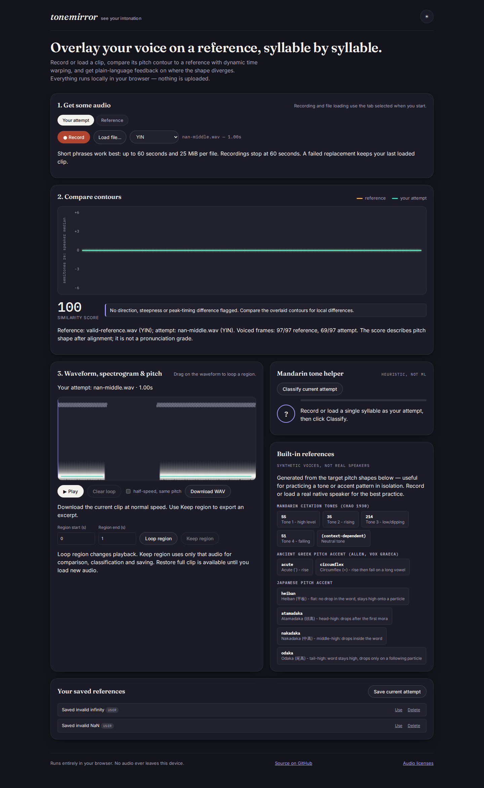
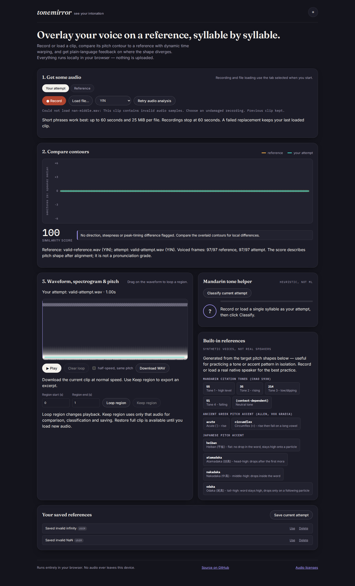

# Damaged decoded audio cannot become a completed practice clip

At baseline `a952c734`, both Chromium and Firefox decode a constructed
one-second IEEE float WAV with a quarter-second of NaN or infinite samples.
The native decoder retains **11,025 non-finite samples** at 44,100 Hz.
ToneMirror commits it as the attempt and reports **100**, using 69 of 97 voiced
frames after the invalid region was treated as unvoiced. Export then rejects
the same clip's invalid PCM. A single invalid sample at the end can fall beyond
the detector's last window and remain entirely absent from the displayed
voicing count.

The browser's completed-clip boundary now requires finite PCM throughout the
buffer. Validation runs in the existing slot worker before pitch and
spectrogram analysis. A failed file/saved-recording replacement keeps the
previous clip's samples, label, comparison and available actions. The stored
recording is not rewritten or deleted. Genuine silence stays valid and has an
unavailable score when it supplies no voiced frames.

This correction does not change the standalone pitch routines' robust handling
of partial signals, the relative pitch-shape heuristic, or phonetic accuracy.
The damaged fixtures are constructed counterexamples, not production incidents.
It checks decoded PCM, rather than proving that every encoded file is intact;
the browser's native decoder still has its documented allocation/cancellation
limits in [audio boundaries](../../docs/audio-boundaries.md).

## Reproduction

```sh
npm ci --ignore-scripts && npm run build
node studies/audio-integrity/browser.mjs dist /tmp/audio-integrity after
```

For the baseline, build `git archive a952c734` and pass its `dist` directory,
using `before` instead of `after`.

[`fixtures.mjs`](fixtures.mjs) constructs IEEE float WAVE bytes independently
of the application's export encoder. The format tag, channel/frame alignment
and floating-point container follow
[Microsoft's WAVEFORMATEX documentation](https://learn.microsoft.com/en-us/windows/win32/api/mmreg/ns-mmreg-waveformatex).
The fixtures include NaN, both infinities, a single last-sample NaN, finite
voiced audio, real zero-valued gaps and complete silence. All source waveforms
are synthetic sine waves, not recorded speech.

[`browser.mjs`](browser.mjs) uses the production build, native `decodeAudioData`,
native IndexedDB and the bundled workers. Observers record the actual decoded
non-finite counts, submitted PCM digests, worker responses and unchanged valid
contour/spectrogram digests. They never substitute decoder or worker results.
It checks both reference/attempt slots and YIN/MPM, with Chromium/Firefox at
1440 and 375 px. Two damaged legacy recordings are seeded into a native v1
database, exercising the existing metadata-index upgrade and selected-record
load path. The backend correction adds no storage migration.

After initial code/font loading, the server is shut down and the context is
offline. Served and browser-loaded assets are byte-matched with the tested
build. The replay checks preserved WAV export bytes, saving, final recovery,
unchanged legacy recording bytes, accessibility, overflow, script/CSP failures
and external/late requests. The baseline captures its delayed export failure.

## Recorded result

| Workflow | Baseline | Corrected |
|---|---|---|
| 64 damaged file imports | Accepted | Rejected before clip commit; previous clip kept |
| 16 damaged saved-record loads | Accepted | Rejected; previous clip and stored recording bytes kept |
| 48 valid voiced/gapped/silent controls | Available according to voicing | Identical PCM, contour, spectrogram and score |
| Last-sample NaN | All 97 frames can appear voiced; score 100 | Entire PCM checked; replacement rejected |
| Preserved-clip playback/export/save | Bad saved clip later fails export | Normal/half-speed playback works; WAV export and saved PCM match the previous valid clip |

The [baseline capture](results/before.json) has **80 disagreements in 128
workflows**; [corrected](results/after.json) has **zero**. All 128 submitted
PCM digests match between phases. Forty-eight valid contour/spectrogram digests
and scores match exactly. A genuine zero-valued gap scores 87 in the retained
YIN control, rather than the initially assumed 100; preservation is checked against
the actual baseline, with no invented phonetic target.

Independent FFmpeg decoding [verifies](results/fixtures.json) every PCM byte and
the exact non-finite count of five source WAV fixtures. It also
[verifies all eight exported WAVs](results/exports.json) against the preserved
clip's PCM digest. One [captured export](results/preserved-clip.wav) is included;
it is a constructed sine wave, not recorded speech. The corrected replay also
checks eight native saved-reference writes and sixteen native normal/half-speed
playback buffers. Both original damaged library records retain their bytes.

At implementation `b835699`, the clean Node 24.21.0 archive passes lint, strict
types, **211 tests in each default/German locale**, **7 existing voice-source
integrity checks**, and **90 browser workflows**. Four Firefox microphone cases
are skipped because the deterministic test microphone is Chromium-only. Physical
microphone/speaker validation is not claimed. All 274 archived input files match
the implementation commit, and all 30 production-build files match Node 24/26
builds. Each replay view byte-matches all 26 served and browser-loaded assets,
then shuts the server down before the audio workflows. The
[verification receipt](results/verification.json) records source, build, input,
output and check-log hashes.





These are actual production pages after the constructed NaN import. The
corrected 100-point score belongs to the retained **valid-attempt.wav**, as its
label and comparison source note show. The failed **nan-middle.wav** is not
graded. Eight study screenshots and twelve existing browser-suite screenshots
were inspected. No application UI code was changed.

The initial saved-record observer sometimes inspected the previous worker job
while IndexedDB was still reading. Final captures wait for a new analysis request
and its terminal response; both phases were rerun. The delayed export diagnostic
is asserted at its actual `download-note` element. These harness corrections did
not alter the application fix or hide an unresolved browser failure.

The application's package is marked private for npm. The original correction was verified
as public source and a local production build. The later
[deployment review](../wav-export/publication/README.md) confirms the hosted
files match the tested source build. No npm release or tag was created.
