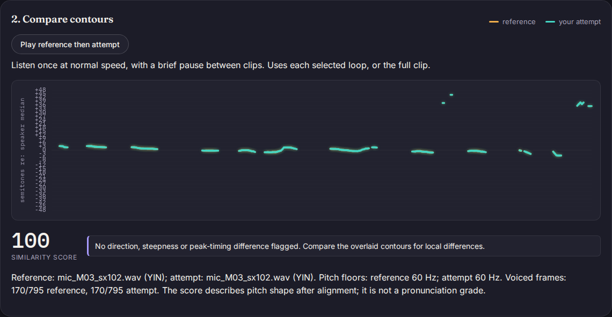
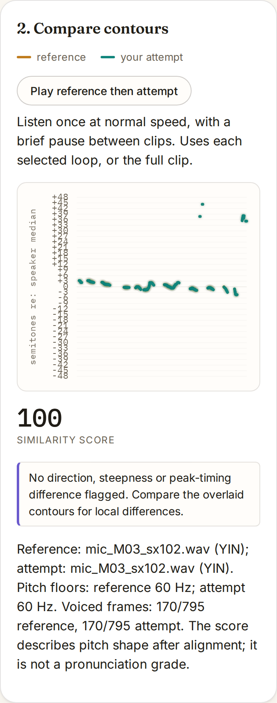
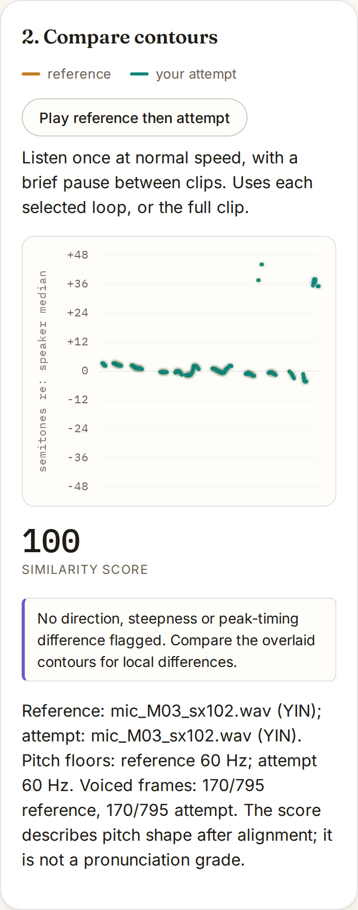

# Readable axes when a recorded contour has large outliers

The comparison chart expanded its pitch range to include every estimate,
but always labelled every third semitone. A real recording, PTDB-TUG
M03 / sx102, expands the range to -48 through +48 semitones relative to
the speaker's median. Drawing 33 labels in 224 CSS pixels placed their
baselines seven pixels apart. Native browser glyph bounds overlap by one
pixel between each neighboring pair.

The grid now doubles its base three-semitone step until neighboring
baselines have at least 22 CSS pixels of space. The median stays labelled
zero. The range and pitch rendering are unchanged: the outliers remain
visible rather than being cropped to make the chart look cleaner.

| Input | Labels before / after | Minimum baseline spacing before / after | Overlapping pairs before / after |
|---|---:|---:|---:|
| Recorded PTDB M03 / sx102 | 33 / 9 | 7 / 28 CSS px | 32 / 0 |
| Synthetic 80 Hz calibration | 5 / 5 | 56 / 56 CSS px | 0 / 0 |

All four browser/viewport pairs produce these results: Chromium and
Firefox at 1440 px / DPR 1 in dark mode and 375 px / DPR 2 in light mode.
The recorded example has a 20-pixel gap between glyph bounds after the
change. The flat calibration has a 48-pixel gap in both versions. Values
are rounded to whole CSS pixels; receipts retain full precision.

Before:



After:


Phone view, before and after:




## What is measured

`replay.mjs` intercepts the real comparison canvas's `fillText`, `stroke`
and path commands while letting the browser execute them normally. Each
`measureText` call supplies the actual glyph ascent/descent for the loaded
11 px IBM Plex Mono font. Bounds are measured in CSS coordinates, including
at DPR 2; this does not mistake physical pixels for layout pixels.

Each input is loaded into both audio tabs. The recording produces 284
contour stroke segments per case; the explicitly synthetic 80 Hz sine
produces 392. **All 2,704 contour stroke segments have identical ordered
coordinates, widths, colors and opacity before and after.** Their hashes
are compared per browser, viewport and input. Both versions score the
self-comparisons 100. That is a preservation control, not a pitch-accuracy
or pronunciation claim. Grid strokes are identified separately by their
one-pixel line width; contour strokes are wider.

All work after initial load completes offline, without HTTP requests,
page errors or CSP violations. The flat control retains its five original
labels. The detector, normalized pitch values, time alignment, confidence
and score computation are untouched. The change addresses label overlap;
it does not correct the recording's large pitch errors or increase the
vertical space available to its smaller movements.

The [before receipt](results/before.json) observes the actual public page
from source `cd802dc`, whose application was deployed in Pages `1104d6a`.
The [after receipt](results/after.json) observes the new local build.
The script asserts overlap in the former and non-overlap in the latter,
with an unchanged zero label and the same narrow-range control.

## Reproduce

From the repository root with the locked dependencies installed:

```sh
python3 -I studies/real-voice/fetch.py --offline
npm run build
npm run preview -- --host 127.0.0.1 --port 4194 --strictPort
# In another shell:
node studies/contour-axis/replay.mjs http://127.0.0.1:4194/tonemirror/ /tmp/contour-axis after
```

If the source cache is absent, first run the fetcher without `--offline`.
The [pinned manifest](../real-voice/manifest.json) identifies the original
recording; the replay refuses a different SHA-256. The original PTDB-TUG
audio is not redistributed. Its database uses
[ODbL 1.0](https://opendatacommons.org/licenses/odbl/1-0/), with
[DbCL 1.0](https://opendatacommons.org/licenses/dbcl/1-0/) for contents.
See the [source project](https://www.spsc.tugraz.at/databases-and-tools/ptdb-tug-pitch-tracking-database-from-graz-university-of-technology.html).
The calibration WAV is generated in memory and explicitly labelled synthetic.

To reproduce the failing baseline, build application source `cd802dc`
and pass `before` as the third argument to this replay script. The retained
script works against both builds. The original public observation remains
an observation of the deployment at the recorded stage, rather than a claim
that the current public page still has the defect.

The [fresh-install receipt](results/verification.json) pins Node 24.22.0,
the 30-file production build, lint/typecheck, 232 unit cases in both required
locales, seven source-integrity controls and 122 passing browser workflows.
Four existing Firefox fake-device microphone cases remain skipped. The
[clean canvas replay](results/clean.json) repeats all eight cases and matches
the working build's measurements and screenshots. All six pitch-detector
files still match the earlier 580-recording replay.
