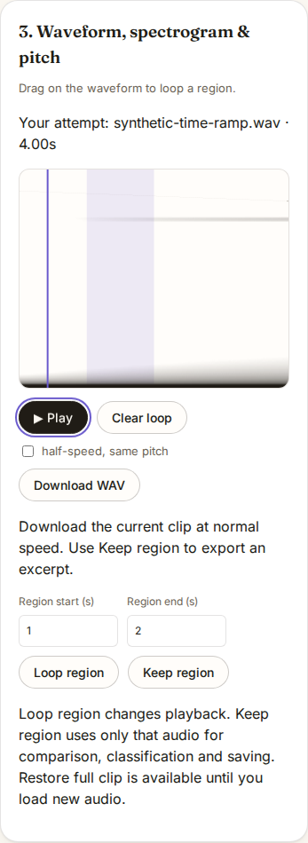
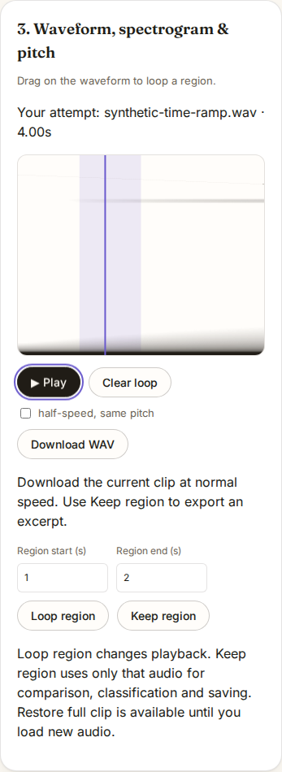

# Play the selected passage from the first sample

Select seconds 1–2 of a four-second clip, then press Play with the cursor at
zero. The baseline `574dc6c3768ded7f10b4692e8622b47c6467bee0` plays seconds
0–2 before its first repeat. Moving a loop ahead of running playback likewise
leaves the earlier audio playing. Both failures reproduce in Chromium and Firefox.

Native loop bounds specify where playback repeats; they do not skip a preceding
offset. This follows the [Web Audio playback algorithm](https://www.w3.org/TR/webaudio-1.0/#playback-AudioBufferSourceNode).
ToneMirror must apply its practice-selection rule before starting the node.

`ClipPlayer` now enters at the loop's beginning when starting outside either
boundary. Moving a playing loop outside the current position restarts the native
source at that entry, preserving its speed and completion callback. Selecting a
loop while paused retains the cursor until Play. Positions inside the selected
passage continue from that position; clearing a loop keeps playback running.

| Observation | Before | After |
| --- | ---: | ---: |
| Native offline renders matching the selected passage and cursor | 60/84 | 84/84 |
| Live loop edits retaining the selected audio and cursor | 12/20 | 20/20 |
| Production app's first normal playback inside the selection | 0/4 | 4/4 |
| Production app's active playback moved into a later selection | 0/4 | 4/4 |
| Production app's first prepared half-speed playback at the selected offset | 0/4 | 4/4 |
| Production app's clear-loop control retaining its active node | 4/4 | 4/4 |
| WAV downloads retaining every original decoded sample | 4/4 | 4/4 |

The mobile screenshots show the same 1–2 second selection. The original cursor
is left of its shaded passage after playback; the corrected cursor is inside it.
These are unedited captures of the actual production builds and a synthetic
time-encoding signal, not recorded speech.




## Native rendering

[`native.mjs`](native.mjs) transpiles the actual `ClipPlayer` source and runs it
against native browser audio nodes. Every synthetic sample encodes its source
time. The offline matrix covers 8,000, 44,100 and 48,000 Hz, normal/prepared
half-speed buffers and seven offsets before, inside, at and beyond the loop.
Each of the 84 cases renders 4,096 samples, compared against a separate native
node whose entry offset is calculated independently of the player's cursor.
All 344,064 corrected samples match exactly; the largest sample difference is zero.

The twice-length synthetic ramp checks prepared-buffer coordinates, not the
audio stretch algorithm's quality. Ten additional live scenarios per browser
enable loops before/after/around the cursor, move a loop's start ahead and clear
it, at both speeds. Their real AnalyserNode output must stay inside the selected
passage and agree with the cursor within 64 ms, allowing main/render-thread
observation skew. Baseline failures are out-of-selection audio, even where the
cursor accurately follows that earlier audio. This is separate from the
[older beyond-loop cursor correction](../loop-playback/README.md).

Native receipts: [before](results/native-before.json), [after](results/native-after.json).

## Production workflow

[`browser.mjs`](browser.mjs) serves the built app, compares response bytes to the
tested files, then stops the server and disconnects before the first file import.
It uses real decoding, workers, audio clocks and playback nodes. In Chromium and
Firefox at 1440 px and 375 px it enters the region by keyboard, observes normal
audio through an AnalyserNode and reads the painted cursor, edits the region
during playback, clears it and prepares actual same-pitch slow playback after a
fresh import. The latter checks the real node's start/loop offsets and native
rate; it does not infer acoustic pitch or stretched-speech timing from the ramp.

Every original decoded PCM sample remains in the downloaded float WAV. Each
workflow also checks page errors, content-security violations, offline requests
and horizontal overflow. All are empty/zero. Before and after each load 26 served
files with hashes matching their respective builds. The eight screenshots were
visually inspected; Firefox and desktop captures accompany the mobile pair above.

Browser receipts: [before](results/browser-before.json), [after](results/browser-after.json).
Clean checkout/build and full regression details: [verification](results/verification.json).

```sh
npm ci
npm run build
node studies/loop-entry/native.mjs . native-replay.json
node studies/loop-entry/browser.mjs dist browser-replay
```

Pass `--baseline` as the last argument to retain failures against an earlier
source tree or build. The drivers record measurements before asserting success.
No microphone, speaker, device latency or acoustic measurement is claimed.
The source correction does not itself establish a hosted deployment.
