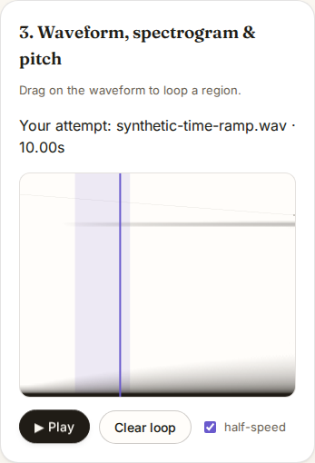

# Keep the loop cursor at the position actually playing

At baseline `69dcb38fd4ee86b2200f7dd5f08e6f2a9fce4a49`, pause a ten-second
clip after five seconds, select a loop from two to four seconds, then resume.
Native audio enters at two seconds. ToneMirror's cursor instead wraps the
paused position with a remainder and displays about three seconds. Moving
a playing loop behind the current position produces the same divergence.

Production correction: `d88315e13fbfcfeebbbcb1e8a33a12e7e8e8af6f`.
`ClipPlayer` now uses the loop's beginning for these entry transitions and
keeps its existing modulo calculation for elapsed playback. Selecting a region
while paused retains the paused cursor until playback resumes. Playback from
before the region still plays that introduction once. Half-speed changes keep
time accumulated at the previous rate.

The [Web Audio start specification](https://webaudio.github.io/web-audio-api/#dom-audiobuffersourcenode-start)
defines offset clamping at the loop boundary; the loop end is exclusive.
The evidence below checks actual native rendering, including live loop edits,
instead of relying on a mocked source node's assigned properties.

## Retained measurements

All input audio here is **synthetic**, a ten-second ramp whose amplitude encodes
source time. It is a timing probe, not speech or a pitch-accuracy fixture.
Browsers: Chromium 153.0.8010.12 and Firefox 155.0 on this WSL2 Linux machine.

| Check | Before | Corrected |
| --- | ---: | ---: |
| Native offline renders matching the reported position | 72/96 | 96/96 |
| Live loop edits within 64 ms of native output | 8/16 | 16/16 |
| Actual app workflows within 64 ms of native output | 0/4 | 4/4 |

[`native.mjs`](native.mjs) transpiles the repository's actual `ClipPlayer` and
loads it into both browsers. Offline cases cover 8, 44.1 and 48 kHz, full and
half speed, and starting offsets 0, 1, 2, 3, 4, 5, 7 and 10 seconds with a
two-to-four-second loop. Each renders 4,096 samples. A separate bare native
`AudioBufferSourceNode` renders from the reported cursor, with the same PCM,
rate and loop. Every corrected output sample matches this independent render
exactly (the acceptance tolerance is 0.000001 in amplitude).

The final output sample also checks the accumulated playback clock. Its
amplitude-derived position is within 0.001 seconds in all corrected cases;
the largest observed difference is 0.000259 seconds. Firefox's half-speed
resampling filter changes amplitude at the initial discontinuity and slightly
changes ramp gain. Comparing the complete native reference render avoids
mistaking that transient for a wrong starting position. `nativeStart` in the
receipts is raw output, including that transient, not a calibrated timestamp.

Live cases enable a loop behind the cursor, shorten an existing loop behind
it, enable one around the cursor, and clear a loop, each at both rates. A real
`AnalyserNode` reads source output while the actual audio clock advances.
The largest corrected gap is 0.016126 seconds. The 64 ms acceptance window
allows four 128-frame render quanta at 8 kHz for main-thread/analyser timing.
Firefox lacks `OfflineAudioContext.suspend`, so live edits use `AudioContext`
in both browsers. Neither harness substitutes simulated audio nodes.

Full rows: [`native-before.json`](native-before.json),
[`native-after.json`](native-after.json).

## Actual application workflow

[`browser.mjs`](browser.mjs) loads the production app, waits for its local fonts,
checks served bytes against the build, stops the static server and puts the
browser offline. It uploads a generated float WAV through the file input,
plays past five seconds, pauses, drags a loop over 20–40% of the waveform,
resumes, then switches to half speed while playing.

Instrumentation observes the existing canvas playhead stroke and reads a real
analyser inserted in the native output path. It does not replace app playback
logic or clocks. Each capture includes at least ten observations at each rate.

| Browser / viewport | Largest gap before, seconds | Largest gap corrected, seconds |
| --- | ---: | ---: |
| Chromium / 1440 px | 1.224683 | 0.001424 |
| Chromium / 375 px | 1.224683 | 0.000180 |
| Firefox / 1440 px | 1.278590 | 0.014550 |
| Firefox / 375 px | 1.280473 | 0.014553 |

Rows and served asset hashes are in [`before/browser.json`](before/browser.json)
and [`after/browser.json`](after/browser.json). All 26 fetched assets match
their respective build. There are no page errors, CSP violations, post-shutdown
HTTP requests or horizontal overflow in these runs. All eight screenshots were
visually inspected. The desktop panel's extra blank height is the existing
grid layout; the synthetic ramp has no meaningful speech contour.

Before and corrected Chromium phone captures, paused after the measured run:




Screenshots show the app state, but do not themselves establish audio timing.
The numeric recordings above provide that evidence.

## Reproduction

From this repository, with the locked dependencies and Playwright browsers
installed:

```sh
npm ci
npm run build
node studies/loop-playback/native.mjs . native-replay.json
node studies/loop-playback/browser.mjs dist browser-replay
```

For the before replay, archive baseline commit
`69dcb38fd4ee86b2200f7dd5f08e6f2a9fce4a49` to a separate directory,
install its dependencies and build it. Pass that directory to `native.mjs`
and its `dist` to `browser.mjs`, adding `--baseline` to retain failures without
asserting that the old behavior is correct. The WAV is generated by the driver;
no external recording or microphone is needed.

[`build.json`](build.json) records all 28 output files, totaling 865,763 bytes.
They match a fresh locked Node 24.21.0 build of the production commit exactly.
The clean archive passes `npm ci`, lint, strict typechecking, 190 unit tests,
the production build, and 59 existing Chromium/Firefox browser scenarios.
Three Firefox scenarios are skipped because their deterministic microphone
comes from Chromium. [`verification.json`](verification.json) records the
commands, results and retained evidence hashes.
This is digital browser validation, not a measurement of speaker, microphone,
device latency or audible quality. No pitch algorithm, recording pipeline,
package version, release tag or hosted deployment changes in this repair.
