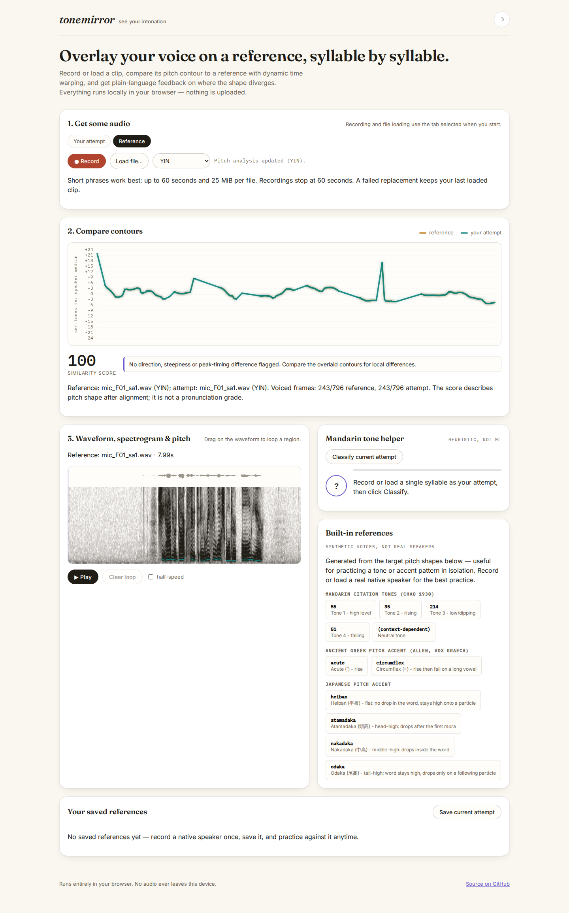

# Faster pitch analysis with the same lag definitions

ToneMirror's direct correlation loops spent most of their time multiplying the
same overlapping speech samples. At the accepted 96 kHz ceiling, ten seconds
of synthetic voiced audio took 2.07 seconds with YIN and 3.49 seconds with MPM
on this machine. The FFT calculation reduces those medians to 0.475 seconds
for each tracker. It retains the existing windows, lag range, thresholds,
interpolation, octave correction and median smoothing.

Baseline: `a8142edebde3a9708ba1a59541e0243136016fc7`.
Implementation: `c42283262461bfaff3ea0affba9e8abb29244dcb`.
This is a source study; these measurements do not establish a hosted deployment.

## Arithmetic and numerical boundaries

YIN compares a fixed window of `W = frame.length - maxLag` samples against
its shifted copy:

```
d(lag) = sum(j=0..W-1, (x[j] - x[j+lag])^2)
       = fixed_energy + shifted_energy - 2 * correlation(lag)
```

The two real signals (fixed window and full frame) are packed into one complex
FFT. Conjugate symmetry recovers their spectra; an inverse transform of
`conj(A)*B` gives the required positive lags. Padding to at least the frame
length suffices because `j+lag` never wraps in the retained range. Subtracting
the first sample removes a constant offset without changing differences and
makes a flat input exactly zero.

MPM retains its shrinking overlap and uses the power spectrum's inverse
transform for autocorrelation. Padding reaches `frame.length + maxLag`.
Prefix and suffix energy sums supply the denominator without subtracting
nearly equal totals. This follows the efficient calculation in section 6 of
[McLeod and Wyvill's paper](https://www.cs.otago.ac.nz/graphics/Geoff/tartini/papers/A_Smarter_Way_to_Find_Pitch.pdf).
The [SciPy correlation documentation](https://docs.scipy.org/doc/scipy/reference/generated/scipy.signal.correlate.html)
also distinguishes the defining direct sum from its Fourier implementation.
No SciPy or other DSP runtime dependency is added.

Both trackers keep direct summation below 512 lags. YIN also keeps it for
windows narrower than 512 samples; MPM keeps it when the lag exceeds half
the frame, so an excluded, high-energy middle cannot swamp weak tail windows.
YIN differences near cancellation and MPM correlations near zero are recomputed
directly (relative cutoff `1e-12`). Those guards preserve exact repetitions and
zero crossings, and can make sparse or degenerate frames slower than ordinary
speech. This is not a worst-case latency bound or bit-identical arithmetic.

FFT stage tables are reused in both directions through size 8192. Their typed
arrays retain at most 262,112 bytes per JavaScript realm, plus small map/array
metadata. Larger stages remain temporary. The spectrogram uses the same FFT;
its butterfly arithmetic and twiddle values are unchanged.

## Speech compatibility

The existing real-voice fetcher first verified all 963 pinned source files
(366,357,392 bytes) and all 100 extracted FDA waveform/reference pairs, offline.
See the [original corpus study](../real-voice/README.md) for selection,
licences and limits. No recordings are redistributed here.

[`compare-corpus.ts`](compare-corpus.ts) replays both revisions at each
recording's native sample rate, with unrounded raw frames and final contours.
The [per-recording results](results/corpus.json) cover:

| Check | Result |
| --- | ---: |
| Recordings | 580 |
| Paired recording/algorithm runs | 1,160 |
| Frame results per revision, across both trackers | 763,220 |
| Voiced/unvoiced changes | 0 |
| Raw or final pitch changes rounded to 0.001 Hz | 0 |
| Largest unrounded pitch difference | 6.105e-11 Hz |
| Largest confidence difference | 8.050e-12 |
| Largest final semitone difference | 1.514e-12 |

The time-domain oracle in `tests/pitchCorrelation.test.ts` checks every lag
for noise, harmonics, flat/DC-offset signals, ramps and boundary impulses,
including FFT-size boundaries and unusual overlap lengths. Separate checks
cover exact repeats, silence, isolated-impulse zero crossings and a large
excluded middle sample. Inputs must remain unchanged.

This establishes compatibility on these inputs. It does not improve the
existing pitch-accuracy estimates, establish pronunciation accuracy, or prove
identical decisions for every floating-point signal at a threshold boundary.

## Native timing

[`benchmark.ts`](benchmark.ts) uses a ten-second synthetic harmonic signal
(180 Hz plus its second harmonic), warms each implementation with one second,
and alternates baseline/candidate order for five measured runs. Table entries
are medians; [all measurements](results/native.json) are retained. The machine
is an AMD Ryzen 7 7800X3D, 14 logical CPUs exposed to WSL2, Node 26.7.0. Other
study jobs were stopped during timing. Timings are descriptive, not a guarantee.

| Sample rate | YIN before / after | MPM before / after |
| --- | ---: | ---: |
| 8 kHz | 26.5 / 31.7 ms | 30.8 / 31.0 ms |
| 16 kHz | 64.9 / 63.6 ms | 113.8 / 109.3 ms |
| 44.1 kHz | 500.0 / 263.3 ms | 846.2 / 269.7 ms |
| 48 kHz | 617.6 / 275.7 ms | 1285.3 / 347.0 ms |
| 96 kHz | 2070.1 / 475.0 ms | 3489.7 / 475.4 ms |

The direct path at low sample rates shows no dependable gain; the 8 kHz YIN
median is slower in this run. The optimization targets larger frames.

## Actual browser uploads

The clean Node 24 build was served to Chromium and Firefox, at 1440 and 375
pixels. After page and font loading, the local server was physically stopped
before the first audio upload. Each algorithm first analyzed the real phrase;
then desktop runs measured three uploads of each fixture (mobile measured one).
Both browsers decoded this machine's uploads at **44.1 kHz**, including the
48 kHz source WAV. Native 96 kHz timings above are not browser-decoder timings.

The phrase is PTDB-TUG `F01/sa1`, 7.99 seconds. The 60-second stress fixture
repeats its PCM and trims the last repetition, without crossfades. It is not a
natural 60-second recording. [`fixtures.py`](fixtures.py) checks the original
and generated bytes against the [fixture receipt](results/fixture.json).

Desktop medians, baseline / candidate:

| Browser | Fixture | Algorithm | Worker round trip | File upload to ready |
| --- | --- | --- | ---: | ---: |
| chromium | 7.99 s phrase | YIN | 395 / 238 ms | 466 / 291 ms |
| chromium | 7.99 s phrase | MPM | 622 / 251 ms | 693 / 301 ms |
| chromium | 60 s repeated phrase | YIN | 1911 / 1153 ms | 2148 / 1385 ms |
| chromium | 60 s repeated phrase | MPM | 2554 / 1409 ms | 2806 / 1623 ms |
| firefox | 7.99 s phrase | YIN | 356 / 219 ms | 546 / 398 ms |
| firefox | 7.99 s phrase | MPM | 473 / 280 ms | 648 / 449 ms |
| firefox | 60 s repeated phrase | YIN | 2380 / 1089 ms | 3418 / 2108 ms |
| firefox | 60 s repeated phrase | MPM | 3775 / 1657 ms | 5013 / 2750 ms |

Worker timing runs from submitting decoded PCM to receiving pitch and
spectrogram results. File-upload timing includes Playwright transfer, browser
decoding, analysis, rendering and the driver's ready-state observation; it is
not a pure DSP measurement. Browser runs were serial, baseline then candidate,
on the same machine; no CPU throttling or phone hardware was used. A narrow
viewport does not simulate a phone processor.

The [comparison](results/browser-comparison.json) checks 32 paired uploads.
Decoded PCM hashes, frame counts, voicing, contours rounded to 0.001 Hz / 1e-6
semitones and confidence, and complete Float32 spectrogram hashes match.
Both trackers give the original phrase a score of 100 against itself in all
eight final comparison captures. There were no page errors, CSP violations,
horizontal overflow, or HTTP requests after the server stopped. Every received
asset body was checked against the tested build.

[Baseline browser records](results/browser-before.json) and
[candidate records](results/browser-after.json) include each timing and hash.
All eight screenshots were visually inspected; each before/after pair is byte-identical:
[before](../../docs/assets/pitch-correlation/before/) and
[after](../../docs/assets/pitch-correlation/after/).



## Clean artifact checks

A fresh archive of `c422832`, installed with `npm ci` under Node 24.21.0,
passed lint, strict type checking, 184 core tests, the production build,
59 browser scenarios and the generated-signal accuracy command. Three
Firefox microphone scenarios are intentionally skipped because they require
Chromium's deterministic fake device. The generated accuracy table matches
the existing README table. This run needed no test retries.

The [build receipt](results/build.json) records 85 matching build/check inputs
and all 28 byte-identical built files between the working checkout and clean
archive. Browser timings above use that clean build. Raw clean-install,
check, build, browser and accuracy logs are retained in `results/`.

The bundled application JavaScript is 56.02 kB (20.12 kB gzip), up from
54.99 kB (19.70 kB gzip). Existing audio limits, cancellation and offline
behavior are unchanged. Timing gains are specific to the measured machine
and inputs; they are not accuracy gains or a universal performance bound.

## Reproduction

Use Node 24 or later. From the repository root, install and verify the pinned
corpus (the fetch command needs network only for missing files). The original
corpus licence and selection notes apply. Keep timings separate from concurrent
tests or corpus jobs.

```sh
npm ci
python3 -I studies/real-voice/fetch.py
study_dir="$PWD/studies/pitch-correlation/cache"
mkdir -p "$study_dir/before"
git archive a8142edebde3a9708ba1a59541e0243136016fc7 | tar -x -C "$study_dir/before"
./node_modules/.bin/tsx studies/pitch-correlation/compare-corpus.ts "$study_dir/before" . "$study_dir/corpus.json"
./node_modules/.bin/tsx studies/pitch-correlation/benchmark.ts "$study_dir/before" . "$study_dir/native.json"
python3 studies/pitch-correlation/fixtures.py "$study_dir/repeated-speech-60s.wav"
npm --prefix "$study_dir/before" ci
npm --prefix "$study_dir/before" run build
npm run build
node studies/pitch-correlation/browser.mjs "$study_dir/before/dist" studies/real-voice/cache/ptdb/F01/mic_F01_sa1.wav "$study_dir/repeated-speech-60s.wav" "$study_dir/browser-before"
node studies/pitch-correlation/browser.mjs dist studies/real-voice/cache/ptdb/F01/mic_F01_sa1.wav "$study_dir/repeated-speech-60s.wav" "$study_dir/browser-after"
python3 studies/pitch-correlation/compare-browser.py "$study_dir/browser-before/browser.json" "$study_dir/browser-after/browser.json" "$study_dir/browser-comparison.json"
```

The corpus replay can be divided across processes with the final `SHARD SHARDS`
arguments; the retained run used four disjoint shards, then checked all 1,160
unique recording/algorithm pairs. Timing runs are serial. The browser driver
requires the installed Playwright Chromium and Firefox binaries. It owns and
closes its static servers and browser contexts.
