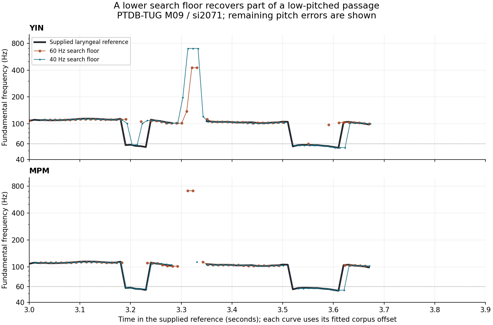
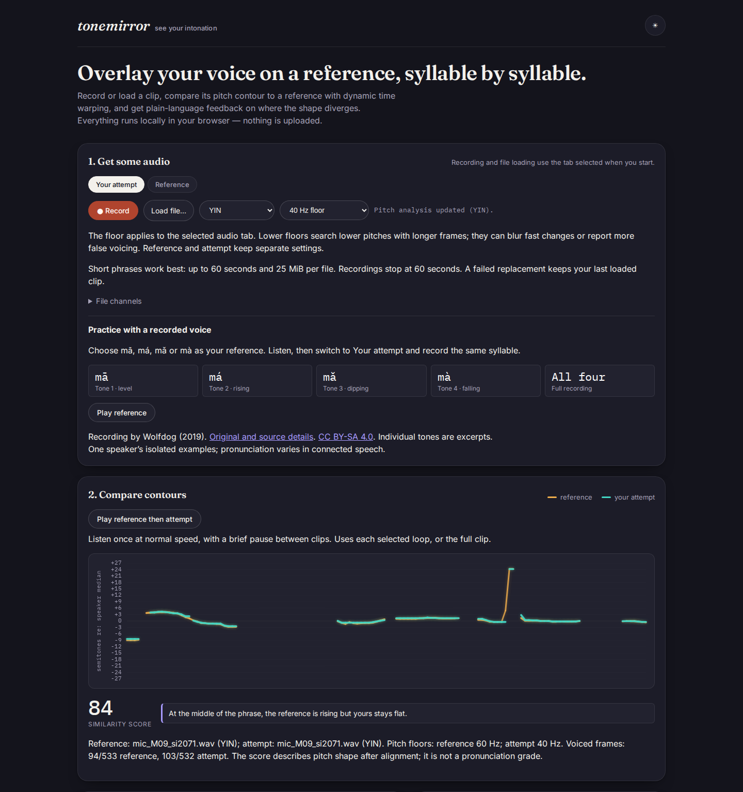

# A pitch search floor for each voice

A low-pitched learner and a higher-pitched reference need not use the same
search range. The browser previously offered YIN or MPM but always used the
core's 60 Hz floor. It now exposes **40, 60 and 90 Hz** separately on each audio
tab. The core already supported a configurable minimum; its detector,
voicing thresholds, smoothing and octave correction are unchanged.

**60 Hz remains the default.** The full replay below supports making a lower
floor an explicit choice, rather than applying it to every recording. It
recovers more of the supplied low-pitch reference but also produces more
false voicing and worse overall voiced-frame agreement. This is a range
control, not a new pitch estimator or a pronunciation result.

## Use the control

1. Select **Reference** or **Your attempt** and load or record a short phrase.
2. Use **Pitch search floor** to change only that tab's analysis. Try 40 Hz
   when listening suggests a lower pitch is missing. Longer frames can blur
   rapid changes; 90 Hz uses shorter frames but excludes more low pitches.
3. Listen and inspect the waveform alongside the contour. The label and
   comparison note show the settings actually used by each loaded clip.

Changing the algorithm reanalyzes both clips with their own floors. A trim or
**Restore full clip** uses that tab's current floor. Failed or cancelled work
keeps the last successfully loaded audio and its analysis labels. After a
failure, the select shows the requested setting and **Retry audio analysis**
retries it. Cancellation restores the floor to the retained clip's setting.
Saved references retain audio, not analysis preferences; **Use**
reanalyzes the recording with the destination tab's current settings. A page
reload resets both floors to 60 Hz. Playback and WAV samples do not change.

| Search floor | Approximate frame duration | Hop | Upper search bound |
|---|---:|---:|---:|
| 40 Hz | 50 ms | 10 ms | 1000 Hz |
| 60 Hz, default | 33 ms | 10 ms | 1000 Hz |
| 90 Hz | 22 ms | 10 ms | 1000 Hz |

At a given sample rate, frame length is `2 * floor(sampleRate / floorHz)`
samples. The presets bound the browser's window size. They change the lag
search and the samples in each frame; they do not simply hide estimates
outside a display range. Octave correction and smoothing can produce a final
estimate below the selected search floor.

## Recorded speech: benefit and cost

The [existing pinned manifest](../real-voice/manifest.json) supplies 480
PTDB-TUG utterances from 20 speakers at 48 kHz and 100 FDA utterances from
two speakers at 20 kHz. Before replay, the offline verifier checked all 963
pinned sources, totaling 366,357,392 bytes, and the FDA extraction. The scorer
checks those original bytes again and compares each captured audio hash.
No recording is added or selected out of the aggregate.

All 580 recordings were run through both algorithms at all three floors:
3,480 contour outputs. Each explicit 60 Hz call was also compared with the
no-option default; **all 1,160 complete contours were JSON-equal**. The six
detector source files match both the original source head
`129cd2f541bed48f8f5c0d0d7716c6ec03163df2` and the replay receipts.

These are **descriptive comparisons with supplied laryngeal reference
contours**, not ground truth for learner pronunciation. A reference-voiced
frame counts as an agreement when the estimate is voiced and differs by
less than 100 cents. A missing estimate is a miss. False voicing is an
estimated voiced frame where the reference is unvoiced. Gross error uses
`abs(estimate - reference) > 0.2 * reference` among jointly voiced frames.

PTDB-TUG, all 480 recordings:

| Method / floor | Within 100 cents / reference voiced | False voiced / reference unvoiced | Below-60 Hz agreements / reference frames |
|---|---:|---:|---:|
| YIN / 40 | 69,978 / 77,433 (90.37%) | 17,524 / 269,395 (6.50%) | 83 / 153 |
| YIN / 60 | 70,386 / 77,433 (90.90%) | 16,408 / 269,395 (6.09%) | 33 / 159 |
| YIN / 90 | 64,931 / 77,433 (83.85%) | 16,062 / 269,395 (5.96%) | 0 / 161 |
| MPM / 40 | 67,344 / 77,433 (86.97%) | 16,289 / 269,395 (6.05%) | 81 / 157 |
| MPM / 60 | 68,770 / 77,433 (88.81%) | 14,063 / 269,395 (5.22%) | 23 / 153 |
| MPM / 90 | 64,742 / 77,433 (83.61%) | 12,338 / 269,395 (4.58%) | 0 / 161 |

Only 42 of the 480 original PTDB reference files have a positive reference
frequency below 60 Hz: 194 original 10 ms reference records. That is a small
and potentially difficult subset. The table's denominators differ from those
raw counts because estimates are evaluated on each setting's own frame grid
with voiced-only interpolation and fitted clock offsets. They are not 194
independent trials or additional people.

FDA, all 100 recordings; there are no below-60 Hz reference frames on the
evaluated grids:

| Method / floor | Within 100 cents / reference voiced | False voiced / reference unvoiced |
|---|---:|---:|
| YIN / 40 | 10,792 / 12,342 (87.44%) | 1,491 / 20,418 (7.30%) |
| YIN / 60 | 10,930 / 12,354 (88.47%) | 1,479 / 20,506 (7.21%) |
| YIN / 90 | 10,884 / 12,343 (88.18%) | 1,576 / 20,617 (7.64%) |
| MPM / 40 | 10,344 / 12,346 (83.78%) | 1,540 / 20,414 (7.54%) |
| MPM / 60 | 10,715 / 12,343 (86.81%) | 1,185 / 20,517 (5.78%) |
| MPM / 90 | 10,747 / 12,349 (87.03%) | 1,067 / 20,611 (5.18%) |

The scorer fits one offset for each corpus, algorithm and floor on a 1 ms
grid from -40 to +60 ms, maximizing reference-voiced agreement within
100 cents. PTDB fits use the original odd-speaker development partition
(240 recordings); FDA uses all 100 recordings. Even PTDB speakers retain
the original comparison partition. Several of their low-pitch recordings
were inspected during exploration: **this is not a fresh held-out study**.
No preset or detector threshold is fitted by the scorer. Frames before or
after the PTDB reference's coverage are excluded, rather than treated as
observed silence. The original study excluded only the tail; this small
boundary difference changes false-voicing denominators at 60 Hz.



This explicitly selected example, PTDB M09 / si2071, illustrates partial
recovery and remaining errors. It is not representative of every recording.
Each curve uses its corpus-fitted timing offset, not a measured browser
latency. Gaps are unvoiced estimates; large remaining errors are visible.

## Actual browser workflow



The screenshot loads the **same M09 / si2071 recording** into both tabs,
reference at 60 Hz and attempt at 40 Hz. Its shape score is 84, despite
identical audio. The score describes the resulting contours and alignment;
it does not establish pronunciation accuracy or improvement.

The browser replay uses that recording and M02 / si759 in Chromium and
Firefox, at 1440 and 375 px: eight real file workflows. The native browser
decoder produced 44.1 kHz audio on this machine, so these checks compare
against direct core replay on the **actual decoded samples**, separately
from the native-rate reference study. Each workflow verifies:

- Default loading, attempt-only range changes, trim/restore and a global
  algorithm change: eight worker analyses per workflow, with independent
  reference and attempt floors. Frame times and voicing match direct core
  replay; frequency differences stay below 0.000001 Hz and confidence
  differences below 0.00000001.
- Four WAV downloads whose bytes are identical across full-clip range,
  trim/restore and algorithm changes. Source WAV files and decoded WAV
  downloads can differ; the exported decoded samples are preserved.
- Completion after disconnecting the page, with no HTTP requests during
  the offline portion, no off-origin requests, browser or CSP errors,
  accessibility violations or horizontal overflow.
- The startup bytes served to the browser match the measured production
  build. Failure and cancellation are exercised separately by the focused
  browser regression, including preservation of the old clip's labels.

The native replay used Node 26.7.0 and NumPy 2.5.3. The production build and
browser replay use Node 24.22.0. These recordings are studio English speech,
not a tonal-language learner study, a microphone/noise benchmark, a
clinical voice assessment or a universally preferred search range.

The [clean-install receipt](results/verification.json) records Node 24.22.0,
`npm ci`, lint, typecheck, 232 unit cases in both default and German locales,
seven study-source integrity controls, the production build and 122 passing
browser workflows. Four existing Firefox fake-device microphone cases are
skipped, rather than counted as passed. All eight real-recorded workflows
were rerun on that build; their measurement results equal the working-build
results, and the receipt pins all 30 production files.

## Reproduce

From the repository root, install the locked dependencies with `npm ci`.
Use Node 24 or newer and Python 3.11 or newer with `uv`. If the original
cache is absent, first run `python3 -I studies/real-voice/fetch.py`; it
downloads the separately licensed source recordings. A complete cache
can be verified without network access:

```sh
python3 -I studies/real-voice/fetch.py --offline
node node_modules/tsx/dist/cli.mjs studies/pitch-floor/capture.ts . /tmp/tonemirror-floor-frames
uv run --script studies/pitch-floor/score.py /tmp/tonemirror-floor-frames /tmp/tonemirror-floor-measurements.json
```

Optional final `SHARD SHARDS` arguments to `capture.ts` split recordings
between ordinary processes sharing an output directory. Complete all shards
before scoring. The retained capture used two shards. Timings in the raw
capture are single samples, not a controlled performance benchmark.

```sh
npm run build
node node_modules/tsx/dist/cli.mjs studies/pitch-floor/browser.mjs dist /tmp/tonemirror-floor-browser
npx playwright test tests/browser/pitch-floor.spec.js
uv run --script studies/pitch-floor/plot.py /tmp/tonemirror-floor-frames /tmp/tonemirror-floor-example.png
```

The plot uses the retained calibration in `results/summary.json`; regenerate
that file from a new scorer output before plotting a changed experiment.
[`results/summary.json`](results/summary.json) retains all integer numerators,
denominators, offsets and code hashes. The compressed
[`results/measurements.json.gz`](results/measurements.json.gz) additionally
retains every captured frame-file and reference hash. Raw frame tables and
original recordings are regenerated locally rather than redistributed.

Sources: [PTDB-TUG](https://www.spsc.tugraz.at/databases-and-tools/ptdb-tug-pitch-tracking-database-from-graz-university-of-technology.html)
(database: [ODbL 1.0](https://opendatacommons.org/licenses/odbl/1-0/),
contents: [DbCL 1.0](https://opendatacommons.org/licenses/dbcl/1-0/));
[CSTR FDA](https://www.cstr.ed.ac.uk/research/projects/fda/)
(no license stated on the project page; site copyright University of
Edinburgh unless otherwise stated). The selected reference plot is derived
from PTDB-TUG. The original audio and full reference tables remain subject
to their source terms.
