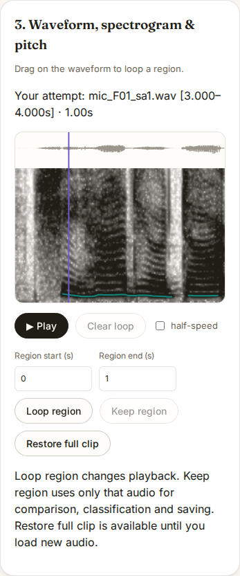

# Make a practice clip from a longer recording

Previously a waveform selection looped playback, while comparison, the tone
helper and saving still used the full clip. That remains the meaning of a
loop. **Keep region** now extracts that passage for all four operations,
without requiring a separate audio editor. Both tabs have keyboard time fields.
The focused reference can be saved directly instead of loading it as an attempt.

## Recorded-speech replay

`browser.mjs` runs against a built site. It verifies the two PTDB-TUG input
recordings against the existing [real-voice manifest](../real-voice/manifest.json),
then loads them through the browser's native decoder. The selected interval is
3 to 4 seconds into each recording. These are English sentences, not annotated
isolated Mandarin syllables; this checks the editing workflow, not pronunciation
or tone-classification accuracy. Recordings are not redistributed here. See the
[source study](../real-voice/README.md#inputs-and-provenance) for provenance.

The baseline is `c78a110ece338794bd78ca72d93280f911803fde`. In each build,
two recordings run in Chromium 153 and Firefox 155 at 1440px/dark and
375px/light: eight workflows per build. Networking is disabled before import.

| Operation | Baseline loop | Keep region |
| --- | --- | --- |
| Audio analyzed and saved | Full recording (about 8 seconds) | Selected 1 second |
| Samples saved, F01 / Chromium | 352,358 | 44,100 |
| Samples saved, M01 / Chromium | 371,321 | 44,100 |
| Difference from expected decoded samples | 0 | 0 |
| Native playback buffer matches excerpt | Not applicable | All 8 workflows |
| Full source restored with identical samples | Not applicable | All 8 workflows |

Both browsers decode at 44.1 kHz here. Firefox's full decoded buffers each
contain one more sample than Chromium's; expected excerpts are taken from
each browser's own full decoded buffer. Extraction does no further resampling.
The selected F01 and M01 excerpts contain 70 and 56 tracked voiced frames,
respectively. Every run matches the bytes of all eight fetched assets to the
tested build, with no offline HTTP requests, external requests, page errors,
CSP violations or horizontal overflow. Results are in
[`before.json`](before.json) and [`after.json`](after.json).



The first exploratory interval (1 to 2 seconds) was leading noise, caught
during visual review. The retained replay uses the spoken 3-to-4-second
interval and requires voiced frames. No speech content or pitch accuracy is
inferred from the sample-equality checks.

## Regression checks

A fresh archive of implementation commit `0ffd177cfc7e63ddee1eef2a40f74ee25a459186`
matched all 230 Git entries. On Node 24.21.0, `npm ci`, lint, type checks,
197 unit tests, the production build and 67 browser workflows pass. Three
existing microphone cases are skipped in Firefox because their deterministic
test device is Chromium-specific. All 12 regression screenshots were inspected.
All 28 build files match the earlier tested build. Repeating the eight speech
workflows from this clean install reproduces the retained results and asset
hashes. The [verification receipt](verification.json) records commands, build
hashes and inspected screenshots.

[`regions.spec.js`](../../tests/browser/regions.spec.js) uses a synthetic
three-second level/rising/falling phrase. Keeping its rising second gives
matching reference and attempt contours, clears the old tone result, and
classifies the extracted rising contour as tone 2. Sample comparisons cover
analysis input, native playback and IndexedDB storage. The scenarios also cover:

- Keyboard loop entry, drag selection, mobile/light and desktop/dark layouts.
- Repeated trims with offsets in the original recording, independent tab state,
  algorithm changes, full restoration and loading new audio.
- Invalid bounds, failed analysis with retry, cancellation and disabled saving
  while an edit is pending.
- Saved excerpts after reload and preservation of a built-in synthetic label.
- Accessibility scans and offline first imports.

The original full source remains only in memory while the clip is loaded.
Saving an excerpt stores just that excerpt. Cuts round outward to decoded
sample boundaries and can click if they do not fall at a zero crossing; this
is not a waveform editor with fades or automatic syllable segmentation.

## Reproduce

After `npm ci` and `npm run build`:

```sh
node studies/practice-regions/browser.mjs dist studies/real-voice/cache /tmp/tonemirror-regions after
npx playwright test tests/browser/regions.spec.js
```

Prepare the cache with the source study's fetcher if needed. For the baseline,
build the pinned source separately and pass its `dist` directory and `before`
to the same script. The script writes its receipt and four after screenshots
to the chosen output directory. This validates local builds; a source push
does not update the hosted demo.
