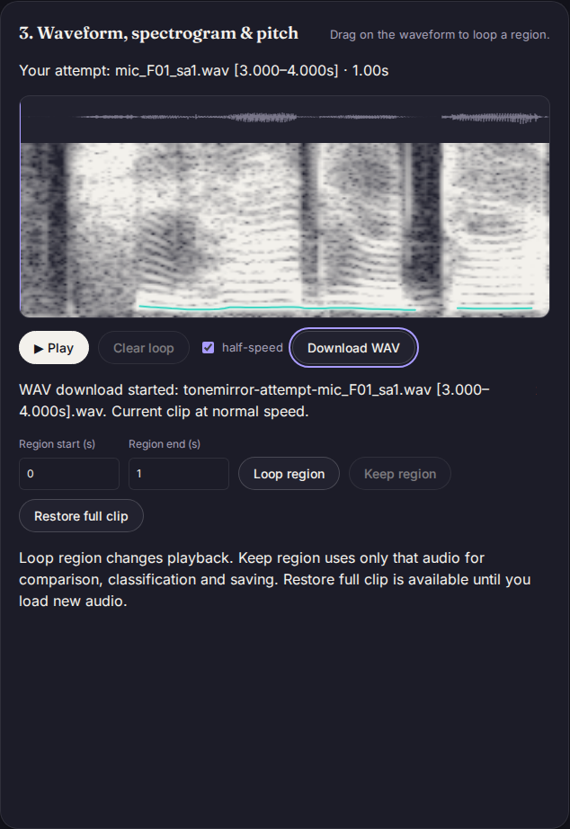

# Take a recording or practice excerpt out of the browser

At baseline `99894ff38323064f604d3440d70978ae92c024ae`, recordings and saved
references could be played, trimmed and compared, but the app offered no audio
download. **Download WAV** now exports the focused attempt or reference. Use
**Keep region** first for an excerpt; **Restore full clip** exports the full
source again. A saved reference can be loaded with **Use** and downloaded too.

| Current state | Downloaded audio |
| --- | --- |
| Full clip | Every decoded mono sample |
| Loop region or half-speed playback | Same full clip, at normal speed |
| Kept region | Only the current excerpt |
| Restored full clip | Original loaded mono samples |
| Saved reference opened with Use | That saved clip's samples |

The button is unavailable while its audio tab is empty or loading. Download
preparation errors leave the current audio available and report the problem
next to the button. The status says that a download started; the page cannot
prove that the user retained the file after the browser's save dialog.

## File format and provenance

The export uses little-endian, mono, 32-bit IEEE float WAV. This preserves the
app's Float32 samples without integer quantization, clipping, resampling or
speed changes. The file contains an 18-byte `fmt ` chunk, a `fact` sample count,
standard RIFF `INFO` metadata and a `data` chunk. Format details follow
[Microsoft's WAVEFORMATEX documentation](https://learn.microsoft.com/en-us/windows/win32/api/mmreg/ns-mmreg-waveformatex)
and the [original Microsoft RIFF/WAVE specifications](https://www.mmsp.ece.mcgill.ca/Documents/AudioFormats/WAVE/Docs/riffmci.pdf).

The filename identifies the audio tab and includes `synthetic` for a generated
reference. Its `ISFT` software field and `ICMT` comment preserve that synthetic
marker when reimported, even if the file is renamed. These are editable metadata,
not authenticated provenance; another editor can strip them. Missing markers do
not establish that audio is recorded speech. The export does not include pitch
contours, similarity scores, library names in metadata or undo history.

These are the **decoded mono samples used by ToneMirror**. Import may already
have resampled the original file and averaged multiple channels. Downloading
does not recover the original codec or stereo channels. A later import on a
device with a different AudioContext sample rate can resample again. Float WAV
support is verified below, not promised for every media player; there is no
compressed or integer-PCM export option.

## Recorded speech, actual downloads and independent decoding

[`browser.mjs`](browser.mjs) uses two unchanged PTDB-TUG microphone recordings,
F01/M01 `sa1`, with source URLs, licenses and hashes from the existing
[real-voice study](../real-voice/README.md). The files are verified against that
manifest before use. They are English sentences, not Mandarin tone-accuracy
evidence. Each is opened in Chromium 153 and Firefox 155 at 1440px/dark and
375px/light: eight offline workflows per build.

[`browser-before.json`](browser-before.json) records the absent download control.
[`browser-after.json`](browser-after.json) retains **48 actual downloads**: full,
looped at half-speed, excerpt, restored, saved and synthetic, in each workflow.
FFprobe recognizes every file as mono `pcm_f32le` at the expected sample rate.
FFmpeg 8.0 decodes each to sample bytes whose SHA-256 matches the exact input
passed to ToneMirror's real analysis worker. Full/looped/restored files are
byte-identical; kept/saved excerpts are byte-identical. The 3-to-4-second speech
excerpt contains exactly 44,100 samples. Reopening it through the browser's
native decoder retains those samples. Renamed synthetic downloads retain their
visible synthetic label.

The static server is stopped before importing speech, trimming, saving or
exporting. All eight fetched assets in every workflow match the tested build.
There are no external or post-disconnection HTTP requests, page errors, CSP
violations, axe violations or horizontal overflow in these checks. Heading font
faces are loaded before disconnection: Firefox can defer offscreen heading
fonts. This checks offline audio workflows, not cold offline availability of
every unused font subset. All eight before/after screenshots were inspected.



A separate regression uses Chromium's test microphone through the native
AudioWorklet recording path and verifies its actual WAV download against the
captured samples. It does not validate a physical microphone. Browser regressions
also cover keyboard download, empty/focused/busy tabs, object URL cleanup,
failed download preparation, retry and cancellation preserving the loaded clip.

[`format-check.mjs`](format-check.mjs) separately checks seven sample rates from
8 to 96 kHz, subarrays, signed zero, subnormal floats and values outside integer
PCM's range against FFmpeg. Its maximum-length case retains all 5,760,000 samples
in a 60-second, 96-kHz clip (23,040,144 bytes). [`format.json`](format.json) records
the hashes and a single local encoding time. That timing is not a browser or
cross-device responsiveness guarantee.

## Reproduce

Install FFmpeg/FFprobe, then build this checkout with `npm ci` and `npm run build`.
Use the real-voice study's hash-pinned cache for the speech input:

```sh
node studies/wav-export/browser.mjs dist studies/real-voice/cache /tmp/wav-export-browser after
node --import tsx studies/wav-export/format-check.mjs /tmp/wav-export-format
npm exec playwright test tests/browser/wav.spec.js
```

For a baseline replay, build `99894ff` separately and pass its `dist` with mode
`before`. The scripts write WAVs, screenshots and JSON into the chosen scratch
directory. Source publication does not deploy the hosted app; version 0.2.3 is
unchanged.
